> **学习版批注（以同目录当前 TypeScript 实现为准）**
>
> 类图用于识别所有权/继承/回调方向，不能把图中有成员误认为该功能已实际接入。例如serverFrameQueue目前未使用。
> 正常收帧时，Manager先对齐并处理包（其中会回调业务），之后才更新serverFrame和统计；回调内部应看传入包的frameIndex。
> 原图中“线性插值预测”实际是沿上一段位移外推。回滚接口当前只合并缓存，不包含完整世界状态恢复与物理重算。
> 生命周期图的setAddServerFrame布尔值要按实现校正：true允许、false禁止；stop实际回UNINITIALIZED，枚举STOPPED并未在stop里使用。
> 追帧软补2/欠账补6是额外执行次数，正常dt累计推进没有同样上限；硬对齐不逐帧发事件。
> 把图中数据类型的关联关系与mng_base_frame_data.ts泛型声明结合阅读，避免把字段包含误解成类继承。以下保留原图。

---

# 帧同步通用框架 — UML 类图 & 时序图

> 所有图表使用 Mermaid 语法，可在 GitHub、VSCode（Mermaid 插件）、Typora 等工具中直接渲染。

---

## 一、UML 类图 — 完整架构

### 1.1 核心类关系总览

```mermaid
classDiagram
    direction TB

    %% ==================== 数据模型层 ====================

    class MngBasePlayerInfo {
        <<interface>>
        +roleId? : Int64
        +name? : string
        +head? : string
    }

    class MngBaseFrameInfo {
        +clientVerify? : number
        +seqId? : number
        +x? : number
        +y? : number
        +direction? : number
    }

    class MngBaseFrameInfos~TInfo~ {
        +simpleInfo? : MngBasePlayerInfo
        +infos? : TInfo[]
    }

    class MngBaseFrameData~TFrameInfos~ {
        +roomId? : number
        +frameIndex : number
        +frames? : TFrameInfos[]
    }

    MngBaseFrameInfos --> MngBasePlayerInfo : 包含 simpleInfo
    MngBaseFrameInfos --> MngBaseFrameInfo : 包含 infos[]
    MngBaseFrameData --> MngBaseFrameInfos : 包含 frames[]

    %% ==================== 配置 ====================

    class MngFrameSyncConfig {
        <<interface>>
        +logicFrameRate : number
        +renderFrameRate : number
        +serverFrameDelay : number
        +maxFrameCache : number
        +enableLocalPredict : boolean
        +enableServerCorrection : boolean
        +logicFrameInterval : number
        +renderFrameInterval : number
    }

    %% ==================== 枚举 ====================

    class MngClientVerifyType {
        <<enumeration>>
        LOCAL_PREDICT = 0
        NORMAL = 1
        LOCAL_CORRECTION = 2
    }

    class MngFrameSyncStatus {
        <<enumeration>>
        UNINITIALIZED = 0
        RUNNING = 1
        PAUSED = 2
        STOPPED = 3
    }

    class MngFrameSyncEventType {
        <<enumeration>>
        FRAME_UPDATE
        FRAME_PREDICT
        FRAME_CORRECT
        FRAME_LOST
        FRAME_ERROR
    }

    %% ==================== 接口 ====================

    class IMngFrameDataHandler~TData~ {
        <<interface>>
        +onClientFrame(frameData: TData) void
        +onServerFrame(frameData: TData) void
        +onServerFrameBatch(frames: TData[])? void
    }

    class IMngFrameSyncLogger {
        <<interface>>
        +isDebugEnabled() boolean
        +log(message, ...args) void
        +warn(message, ...args) void
        +error(message, ...args) void
    }

    class MngFrameSyncStats {
        <<interface>>
        +currentLogicFrame : number
        +currentRenderFrame : number
        +serverFrame : number
        +predictFrameCount : number
        +correctFrameCount : number
        +lostFrameCount : number
        +networkLatency : number
    }

    %% ==================== 帧缓冲区 ====================

    class MngFrameBufferItem~TFrameInfos~ {
        <<interface>>
        +frameIndex : number
        +clientFrame? : TFrameInfos
        +serverFrame? : TFrameInfos
        +confirmed : boolean
        +timestamp : number
    }

    class MngFrameBuffer~TFrameInfos~ {
        -buffer : Map~number, MngFrameBufferItem~
        -maxSize : number
        -minFrame : number
        -maxFrame : number
        +addClientFrame(frameIndex, frameInfo) void
        +addServerFrame(frameIndex, frameInfo) void
        +getFrame(frameIndex) MngFrameBufferItem
        +getClientFrame(frameIndex) TFrameInfos
        +getServerFrame(frameIndex) TFrameInfos
        +hasFrame(frameIndex) boolean
        +isFrameConfirmed(frameIndex) boolean
        +getFramesInRange(start, end) MngFrameBufferItem[]
        +checkLostFrames(currentFrame, lookback) number[]
        +checkLostFrame(currentFrame, lookback) number
        +cleanup(beforeFrame) void
        +clear() void
    }

    MngFrameBuffer --> MngFrameBufferItem : 管理

    %% ==================== 帧预测器 ====================

    class MngFramePredictor~TInfo_TFrameInfos~ {
        -frameBuffer : MngFrameBuffer
        -enablePredict : boolean
        +predictNextFrame(currentFrame, localPlayerData) TFrameInfos
        +predictFrames(startFrame, count, localPlayerData) TFrameInfos[]
        -predictValue(prev, current, input) number
        +setEnablePredict(enable) void
        +getEnablePredict() boolean
    }

    MngFramePredictor --> MngFrameBuffer : 依赖（读取历史帧）

    %% ==================== 帧矫正器 ====================

    class MngFrameCorrector~TInfo_TFrameInfos~ {
        -frameBuffer : MngFrameBuffer
        -enableCorrection : boolean
        -correctionThreshold : number
        +normalizeDirection : Function（钩子）
        +getPlayerKey : Function（钩子）
        +correctFrame(frameIndex, serverFrame) boolean
        -createFrameFromServer(frameIndex, serverFrame, rid) boolean
        -mergeServerFrame(frameIndex, clientFrame, serverFrame, rid) boolean
        -applyCorrection(clientInfo, serverFrame, serverInfo) void
        +rollbackAndReapply(from, to, serverData) void
        +setEnableCorrection(enable) void
        +setCorrectionThreshold(threshold) void
    }

    MngFrameCorrector --> MngFrameBuffer : 依赖（读写帧数据）

    %% ==================== 核心控制器 ====================

    class MngClientFrameSyncManager~TInfo_TFrameInfos_TFrameData~ {
        -config : MngFrameSyncConfig
        -status : MngFrameSyncStatus
        -frameBuffer : MngFrameBuffer
        -predictor : MngFramePredictor
        -corrector : MngFrameCorrector
        -currentLogicFrame : number
        -currentRenderFrame : number
        -serverFrame : number
        -dataHandler : IMngFrameDataHandler
        -logger : IMngFrameSyncLogger
        -eventCallbacks : Map
        +init() void
        +updateLogicFrame(deltaTime) void
        +updateRenderFrame(deltaTime) void
        +addClientFrame(frameIndex, frameInfo) void
        +addServerFrame(frameData) void
        +beginServerFrameBatch() void
        +beginServerFrameReplayBatch() void
        +endServerFrameBatch(flush) void
        +setDataHandler(handler) void
        +setLogger(logger) void
        +getCorrector() MngFrameCorrector
        +getPredictor() MngFramePredictor
        +getFrameBuffer() MngFrameBuffer
        +getStats() MngFrameSyncStats
        +on(eventType, callback) void
        +off(eventType, callback) void
        +pause() void
        +resume() void
        +stop() void
        +destroy() void
        -advanceLogicFrameOnce() void
        -alignClientFrameToServer(serverFrameIndex) void
        -processServerFrameData(frameData) void
        -syncClientFrameWithServer() void
        -syncFramesToLogicFrame(targetLogicFrame) void
        -updateNetworkStats() void
        -emit(eventType, data) void
    }

    MngClientFrameSyncManager *-- MngFrameBuffer : 组合
    MngClientFrameSyncManager *-- MngFramePredictor : 组合
    MngClientFrameSyncManager *-- MngFrameCorrector : 组合
    MngClientFrameSyncManager --> MngFrameSyncConfig : 使用
    MngClientFrameSyncManager --> IMngFrameDataHandler : 回调
    MngClientFrameSyncManager --> IMngFrameSyncLogger : 日志
    MngClientFrameSyncManager --> MngFrameSyncStats : 产出

    %% ==================== 协议层 ====================

    class MngFrameSendParams {
        <<interface>>
        +roomId : number
        +frameIndex : number
        +x : number
        +y : number
        +direction : number
        +seqId? : number
    }

    class MngBaseFrameSyncProtocol~TSendParams_TFrameInfos_TFrameData~ {
        <<abstract>>
        #_inited : boolean
        #logger : IMngFrameSyncLogger
        +onFrameReceived : Function（回调）
        +onReconnectReceived : Function（回调）
        +init() void
        +unInit() void
        +setLogger(logger) void
        #registerMsg()* void
        #unregisterMsg()* void
        +sendFrame(params)* void
        +sendReconnect(roomId, frameIndex)* void
        #onDelayDetected(intervalMs) void
    }

    MngBaseFrameSyncProtocol --> IMngFrameSyncLogger : 日志
    MngBaseFrameSyncProtocol --> MngFrameSendParams : 发送参数

    %% ==================== 驱动层 ====================

    class MngBaseFrameSyncDriver~TInfo_TFrameInfos_TFrameData_TSendParams~ {
        <<abstract>>
        #clientSyncManager : MngClientFrameSyncManager
        #config : MngFrameSyncConfig
        #logger : IMngFrameSyncLogger
        -ctrlAddServerFrame : boolean
        -lastContiguousServerFrameIndex : number
        -pendingReconnectFromFrame : number
        +init() void
        +initSyncClient() void
        +setAddServerFrame(value) void
        +setLogger(logger) void
        +addServerFrame(rawMsg, frameIndex, roomId) void
        +addClientFrame(frameIndex, frameInfo) void
        +reconnectGame(roomId, historyFrames) void
        +updateLogicFrame(dt) void
        +updateRenderFrame(dt) void
        +getSyncManager() MngClientFrameSyncManager
        +unInit() void
        #createConfig() MngFrameSyncConfig
        #setupEventListeners()* void
        #setupDataHandler()* void
        #getProtocol()* MngBaseFrameSyncProtocol
        #convertRawMsgToFrameData(rawMsg)* TFrameData
    }

    MngBaseFrameSyncDriver *-- MngClientFrameSyncManager : 组合
    MngBaseFrameSyncDriver --> MngBaseFrameSyncProtocol : 依赖（缺帧重连）
    MngBaseFrameSyncDriver --> MngFrameSyncConfig : 创建
    MngBaseFrameSyncDriver --> IMngFrameSyncLogger : 日志
```

### 1.2 数据模型继承关系（泛型展开）

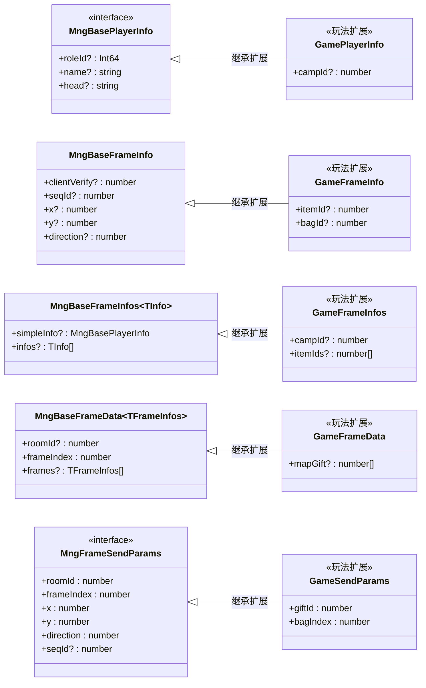

### 1.3 抽象基类与子类继承关系

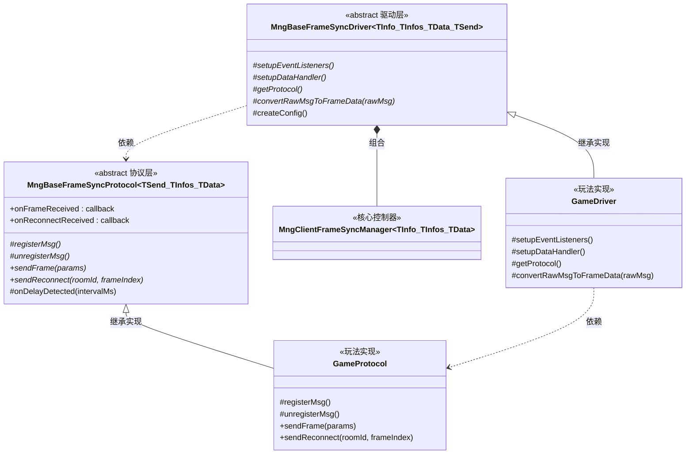

### 1.4 核心控制器内部组合关系

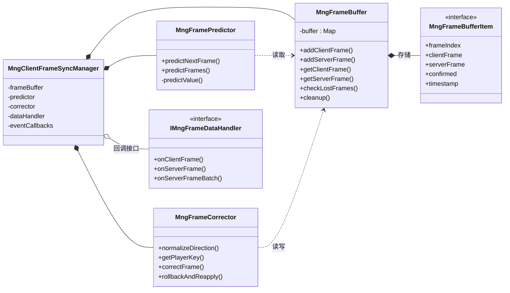

---

## 二、时序图

### 2.1 正常帧同步 — 服务器帧处理全流程

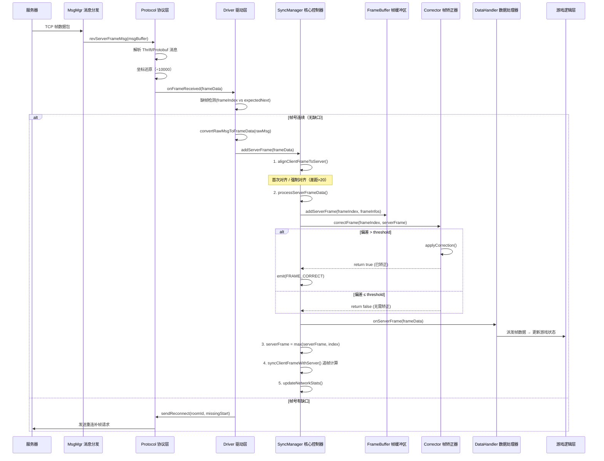

### 2.2 客户端帧处理 — 本地操作发送流程

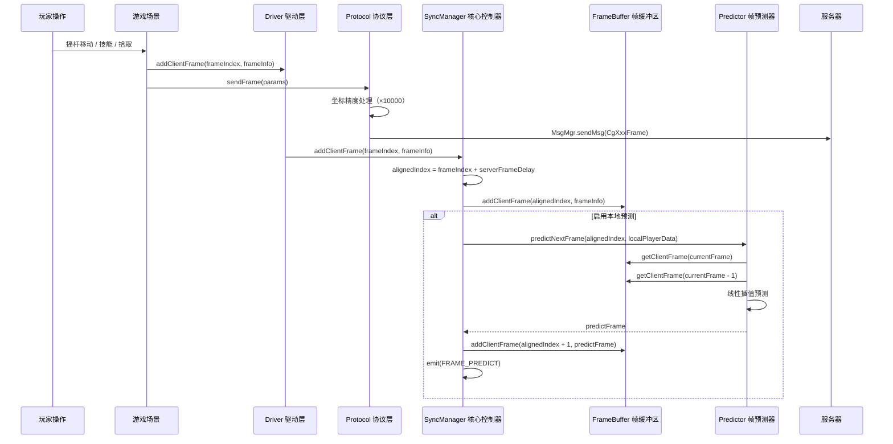

### 2.3 主循环帧驱动 — 逻辑帧推进与追帧

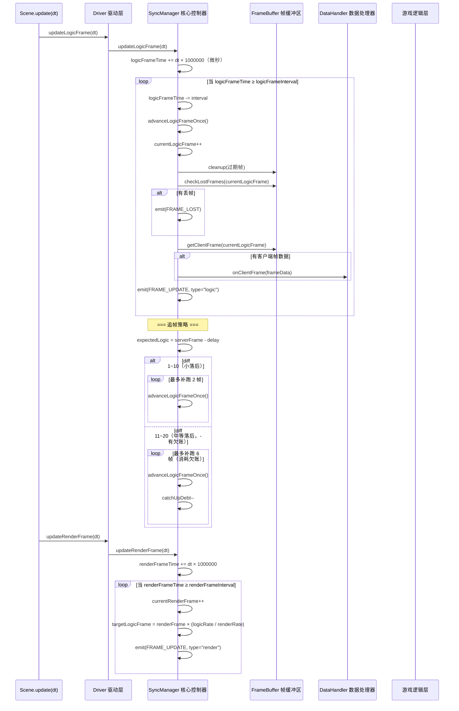

### 2.4 断线重连 — 完整时序

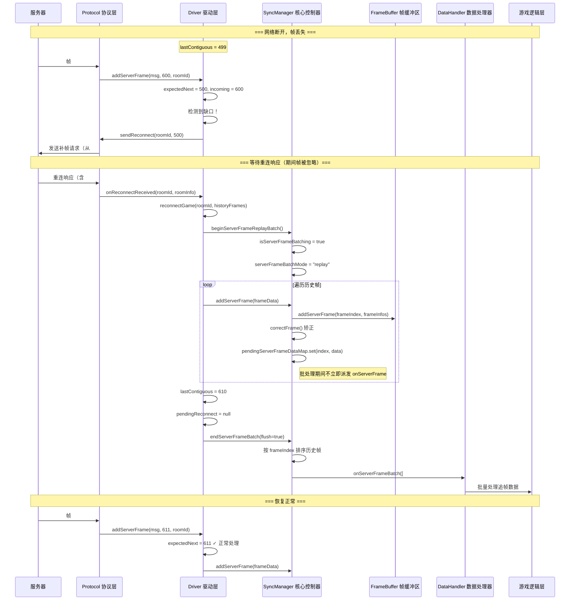

### 2.5 帧矫正 — 服务器权威矫正流程

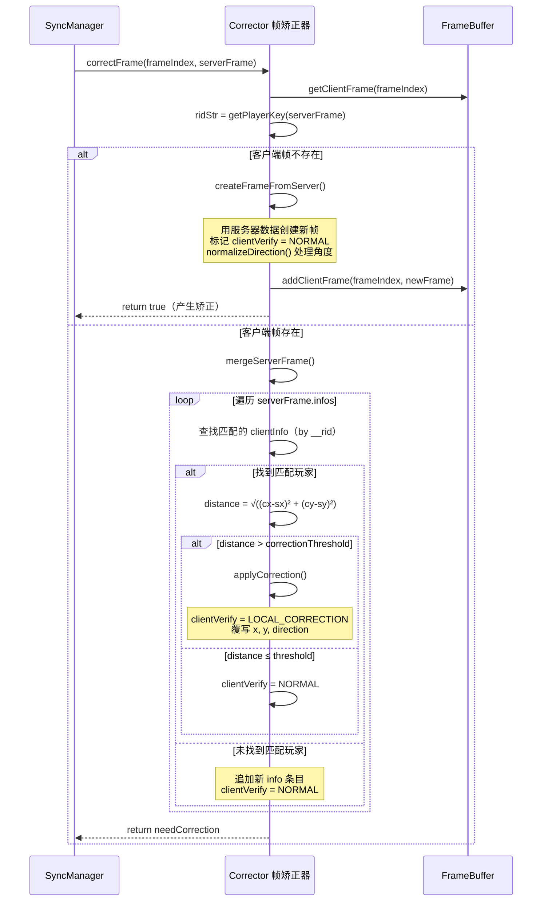

### 2.6 完整生命周期 — 进房到离房

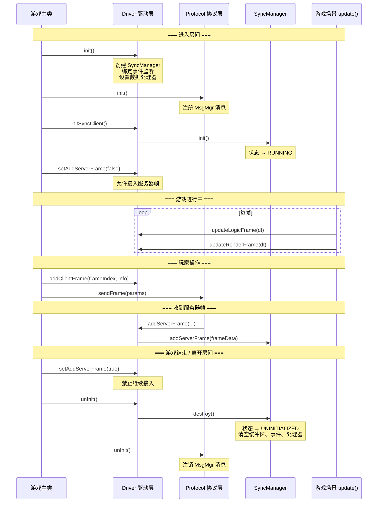

---

## 三、状态机

### 3.1 SyncManager 状态转换

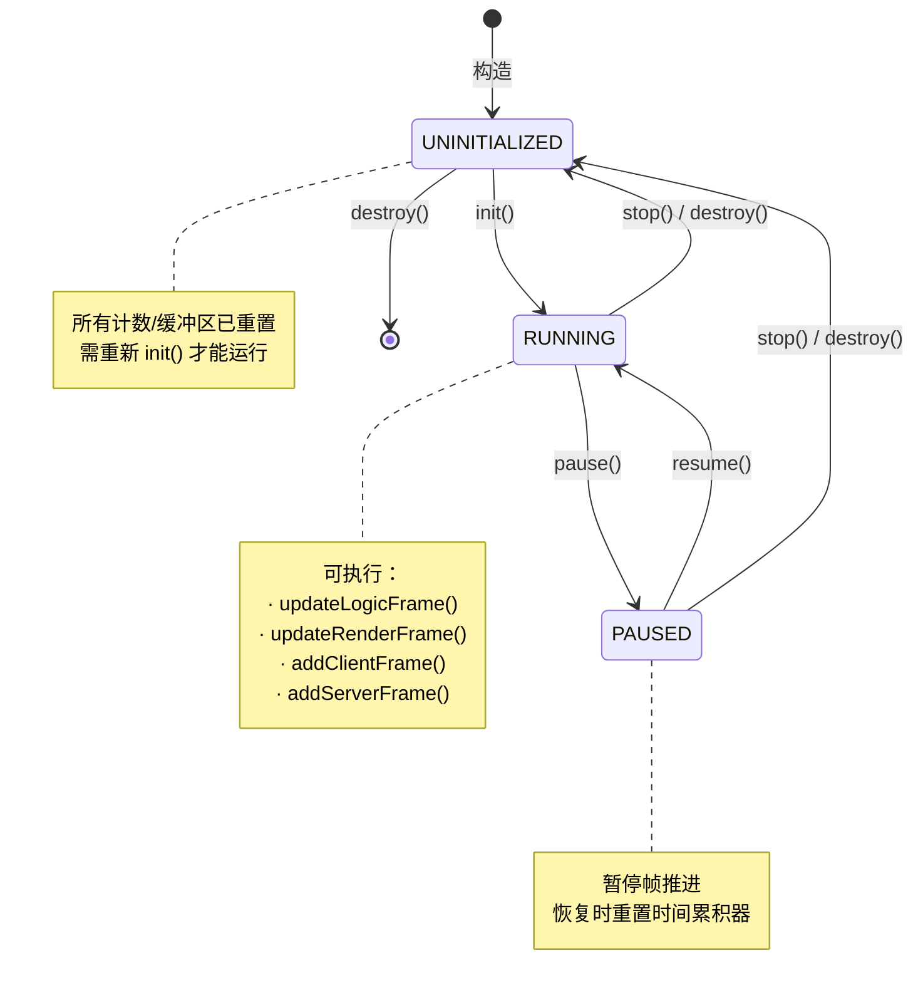

### 3.2 追帧策略状态

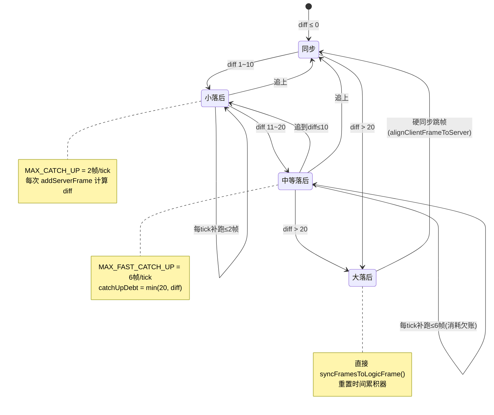
